# TP3 – Réseaux convolutifs (CSC 8607)

Nom : Mabahej


---

## Exercice 1 : Préparation d'ImageNet et augmentation de données

### Question 1.a – Code

Voir `train_imagenet.py`.

### 1 – Que se passe-t-il si on oublie `transforms.Normalize` ?

Sans `Normalize`, les pixels restent entre 0 et 1, avec une moyenne d'environ 0,45. Les entrées sont donc positives et non centrées.

- **Mathématiquement :** le gradient d'un poids est `dL/dw_i = δ × x_i`. Des entrées positives peuvent rendre les gradients corrélés, ce qui ralentit la convergence.
- **Numériquement :** les différences d'échelle entre les canaux peuvent compliquer l'optimisation et rendre l'apprentissage moins stable.
- **Avec `Normalize` :** les canaux sont centrés et mis à l'échelle, ce qui facilite généralement un apprentissage plus rapide et stable.

**Pourquoi calculer la moyenne et l'écart-type uniquement sur le jeu d'entraînement ?**

Utiliser les statistiques de validation introduirait une fuite d'information (*data leakage*). On calcule donc ces statistiques sur le train, puis on applique les mêmes valeurs aux jeux d'entraînement, de validation et de test.

### 2 – Pourquoi ces transformations différentes ?

- **Train :** `RandomResizedCrop` et `RandomHorizontalFlip` ajoutent des variations aléatoires aux images, ce qui augmente la diversité des données et limite le surapprentissage.
- **Validation :** `Resize(256)` et `CenterCrop(227)` donnent des images déterministes, permettant de comparer les performances entre les époques de manière cohérente. Le flip est inutile pour une évaluation reproductible.

### 3 – Exemple où `RandomHorizontalFlip` est néfaste

- **Lettres et chiffres :** un « b » inversé peut ressembler à un « d », ce qui peut modifier le sens de l'image.
- **Panneaux de circulation :** inverser un panneau indiquant de tourner à gauche peut le faire ressembler à un panneau indiquant de tourner à droite.

Dans ces cas, le retournement horizontal peut rendre l'image incompatible avec son étiquette et nuire à l'apprentissage.

---

## Exercice 2 : MLP vs AlexNet

### Question 2.a – Code

Voir `train_imagenet.py`. 

###  1 – Nombre de paramètres du MLP

Entrée : 3 × 227 × 227 = **154 587**.

| Couche | Poids | Biais | Total avec biais |
|---|---|---|---|
| Linear 1 : 154 587 → 256 | 154 587 × 256 = 39 574 272 | 256 | 39 574 528 |
| Linear 2 : 256 → 256 | 256 × 256 = 65 536 | 256 | 65 792 |
| Linear 3 : 256 → 1000 | 256 × 1000 = 256 000 | 1000 | 257 000 |
| **Total** | **39 895 808** (sans biais) | 1 512 | **39 897 320** (avec biais) |

La **première couche** concentre 39 574 528 / 39 897 320 ≈ **99,2 %** des paramètres (donc plus de 99 %).

###  2 – Défaut structurel du MLP sur une image aplatie

Avec `flatten`, l'image devient un long vecteur : on **perd la structure spatiale** (on ne sait plus quels pixels sont voisins). Chaque pixel a ses propres poids, sans **partage de poids**. Le réseau n'a donc pas d'**invariance par translation** : un objet à un autre endroit de l'image doit être réappris séparément. C'est inefficace et ça sur-apprend facilement.

### Question 2.b – Tableau AlexNet complété

Formule de la taille de sortie : `sortie = floor((H + 2P − K) / S) + 1`.
Paramètres d'une convolution : `filtres × (C_entrée × K × K) + filtres` (le dernier terme = biais).
Mémoire : `C × H × W × 4 octets / 1024` (une image, float32).

| Couche | Entrée (C, H×W) | Hyperparamètres | Sortie (C, H×W) | # Paramètres (avec biais) | Mémoire sortie (KB) |
|---|---|---|---|---|---|
| Conv1 + ReLU | 3, 227×227 | 64, 11×11, S=4, P=2 | 64, 56×56 | 23 296 | 784,00 |
| MaxPool1 | 64, 56×56 | 3×3, S=2, P=0 | 64, 27×27 | 0 | 182,25 |
| Conv2 + ReLU | 64, 27×27 | 192, 5×5, S=1, P=2 | 192, 27×27 | 307 392 | 546,75 |
| MaxPool2 | 192, 27×27 | 3×3, S=2, P=0 | 192, 13×13 | 0 | 126,75 |
| Conv3 + ReLU | 192, 13×13 | 384, 3×3, S=1, P=1 | 384, 13×13 | 663 936 | 253,50 |
| Conv4 + ReLU | 384, 13×13 | 256, 3×3, S=1, P=1 | 256, 13×13 | 884 992 | 169,00 |
| Conv5 + ReLU | 256, 13×13 | 256, 3×3, S=1, P=1 | 256, 13×13 | 590 080 | 169,00 |
| MaxPool3 | 256, 13×13 | 3×3, S=2, P=0 | 256, 6×6 | 0 | 36,00 |
| Flatten + Dropout | 256, 6×6 | p = 0,5 | 9216 (1D) | 0 | 36,00 |
| Linear1 + ReLU + Dropout | 9216 | 4096 neurones (p = 0,5) | 4096 | 37 752 832 | 16,00 |
| Linear2 + ReLU | 4096 | 4096 neurones | 4096 | 16 781 312 | 16,00 |
| Linear3 (Sortie) | 4096 | 1000 classes | 1000 | 4 097 000 | 3,91 |
| **Total** | | | | **61 100 840** | **≈ 2339,16** |

Exemples de calcul :

- Conv1 : sortie = (227 + 4 − 11) / 4 + 1 = 56. Paramètres = 64 × (3 × 11 × 11) + 64 = 23 232 + 64 = 23 296. Mémoire = 64 × 56 × 56 × 4 / 1024 = 784 KB.
- MaxPool1 : (56 − 3) / 2 + 1 = 27 (en entiers, 53 / 2 = 26 donc 26 + 1 = 27).
- Linear1 : 9216 × 4096 + 4096 = 37 752 832.

### 2 – Où sont les paramètres et où est la mémoire ?

- **Paramètres :** ils sont principalement dans les couches denses (`Linear`). Les trois couches denses contiennent 58 631 144 paramètres, soit environ **96 % du total**. Les cinq convolutions en contiennent 2 469 696 (environ 4 %). `Linear1` est la plus grande couche, avec environ 62 % des paramètres.
- **Mémoire des activations :** elle est principalement utilisée par les couches convolutives, qui produisent de grandes cartes de caractéristiques. `Conv1` utilise à elle seule 784 KB. Au total, la partie convolutive représente environ 2 267 KB sur 2 339 KB, soit **environ 97 %**. Les couches denses utilisent beaucoup moins de mémoire pour leurs activations.

### 3 – Mémoire AlexNet vs MLP : le paradoxe

- **MLP :** les sorties contiennent 256 + 256 + 1 000 = 1 512 valeurs, soit environ **5,9 KB par image** en utilisant 4 octets par valeur.
- **AlexNet :** les activations occupent environ **2 339 KB par image**, soit près de 400 fois plus que pour le MLP.

Pourtant, les deux réseaux possèdent un nombre de paramètres du même ordre de grandeur : environ 40 millions pour le MLP et 61 millions pour AlexNet.

Cette différence s'explique par leur architecture :

- **Couche dense :** chaque neurone produit une sortie, et chaque poids est utilisé pour calculer cette sortie. Le réseau peut avoir beaucoup de paramètres sans produire beaucoup d'activations.
- **Couche convolutive :** les mêmes filtres sont réutilisés à différentes positions de l'image. Cela limite le nombre de paramètres, mais produit de grandes cartes de caractéristiques contenant beaucoup d'activations.

Ainsi, **le nombre de paramètres ne détermine pas à lui seul la mémoire nécessaire**. Pendant l'entraînement, les activations doivent être conservées pour calculer les gradients. Avec un batch de 256 images, AlexNet nécessite environ `2 339 KB × 256 ≈ 585 Mo` pour les activations, en plus de la mémoire occupée par les paramètres, les gradients et les états de l'optimiseur.

### Question 2.c – Vérification avec `count_parameters`

Commande : `python train_imagenet.py --params`

Résultats :
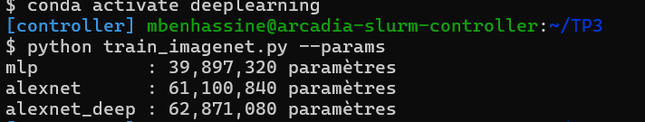
```
mlp          : 39,897,320 paramètres
alexnet      : 61,100,840 paramètres
alexnet_deep : 62,871,080 paramètres
```

---

## Exercice 3 : Entraînement, Early Stopping et comparaison

### Question 3.a – Code

Voir `train_imagenet.py` : `model.eval()` dans `evaluate`, `model.train()` dans la boucle d'entraînement.

Early Stopping (patience = 5) :

```python
if val_loss < best_val_loss:
    best_val_loss = val_loss
    early_stop_counter = 0
else:
    early_stop_counter += 1
    if early_stop_counter >= patience:
        print("Early stopping déclenché !")
        break
```

Si la loss de validation s'améliore, on garde le meilleur résultat et on remet le compteur à 0. Sinon on compte. Après 5 époques de suite sans amélioration, on arrête.


###  1 – Rôle de `model.eval()` et `model.train()`

- `model.train()` **active** le Dropout : à chaque passage, chaque neurone de la couche est mis à 0 avec une probabilité p = 0,5, et les neurones gardés sont multipliés par 1/(1 − p) = 2. Cela évite que le réseau dépende trop de certains neurones (régularisation).
- `model.eval()` **désactive** le Dropout : tous les neurones sont utilisés, sans aléatoire.
- **Si on oublie `model.eval()` pendant l'évaluation** : le Dropout reste actif. Les prédictions sont bruitées et plus mauvaises (loss plus haute, accuracy plus basse), et deux évaluations du même modèle donnent des résultats différents. L'évaluation n'est plus fiable ni reproductible.

###  2 – Valeurs théoriques à l'initialisation

Les valeurs théoriques pour une classification aléatoire parmi 1000 classes sont une accuracy de 0,1 % et une CrossEntropyLoss de ln(1000) ≈ 6,908.

Les premières époques du modèle AlexNet Deep sont cohérentes avec cette référence : à l'époque 1, la perte d'entraînement est de 6,9080 et l'accuracy d'entraînement de 0,09 %. La perte de validation est de 6,9074 et l'accuracy de validation de 0,16 %. Ces résultats indiquent qu'au début de l'entraînement, le modèle effectue des prédictions proches du niveau aléatoire.

###  3 – Comparaison MLP vs AlexNet (20 000 images)
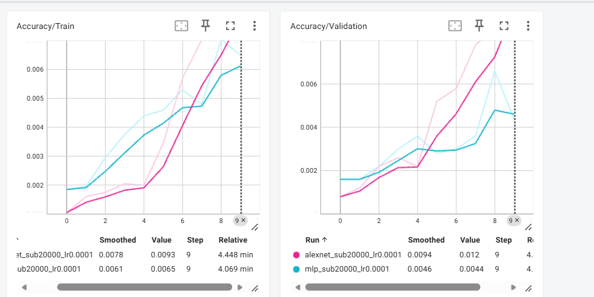
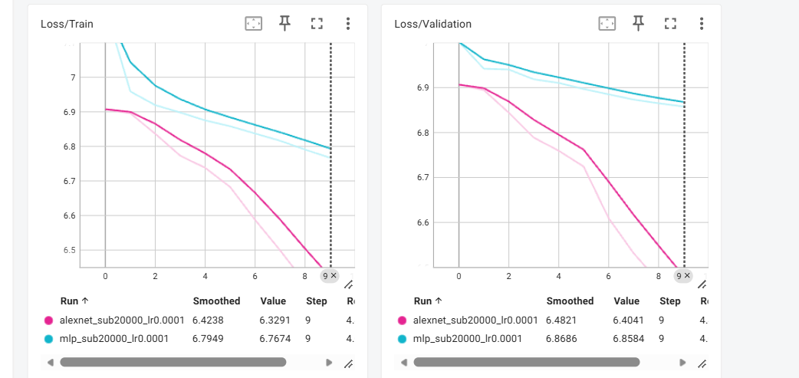


Au départ (époque 0), les loss sont proches de ln(1000) ≈ 6,908 (le MLP commence même un peu au-dessus, vers 7) et l'accuracy est proche du hasard (0,001).
 
Analyse :
 
- **AlexNet apprend mieux que le MLP.** À la fin, sa loss est plus basse d'environ 0,44 (6,33 contre 6,77 en train, 6,40 contre 6,86 en validation) et son accuracy de validation est environ 2,7 fois plus haute (1,2 % contre 0,44 %). Elle reste faible, mais elle est déjà 12 fois plus haute que le hasard (0,1 %), contre 4,4 fois pour le MLP.
- **Pourquoi :** AlexNet utilise des convolutions. Les filtres sont partagés sur toute l'image et gardent la structure spatiale (invariance par translation). Le MLP aplatit l'image et doit apprendre un poids pour chaque pixel (39,6 millions de poids dans la première couche seule pour seulement 20 000 images), donc il apprend plus lentement.
- **Pas de surapprentissage visible sur ces 10 époques.** Les loss d'entraînement et de validation baissent ensemble et l'écart reste petit (0,075 pour AlexNet, 0,091 pour le MLP). Les deux modèles sont encore au **début** de l'apprentissage (loss proche de 6,9, accuracy autour de 1 %) : c'est plutôt un apprentissage lent qu'un surapprentissage. Avec un learning rate de 1e-4 et environ 79 itérations par époque, on n'a fait qu'environ 790 mises à jour de poids.
- **Forme des courbes :** celle d'AlexNet reste plate pendant 1 à 2 époques puis descend de plus en plus vite. Celle du MLP descend lentement et presque en ligne droite.
- **Limite :** la validation utilise seulement 5000 images (20 000 / 4). Une image représente 0,02 % d'accuracy, donc les courbes d'accuracy sont bruitées (le pic du MLP à l'époque 8 en est un exemple).
Conclusion : AlexNet est meilleur que le MLP dès les premières époques. Pour voir le surapprentissage (loss d'entraînement qui continue de baisser pendant que la loss de validation remonte), il faudrait entraîner plus longtemps.
 
### Question 3.b – AlexNet plus profond

Voir la classe `AlexNetDeep` dans `train_imagenet.py` : 3 convolutions `256 × 3 × 3` (padding 1) + ReLU ajoutées juste après Conv5. Le nombre de paramètres augmente de 3 × 590 080 = 1 770 240, soit 62 871 080 au total.

Commande : `python train_imagenet.py --model alexnet_deep --subset 20000 --epochs 10`

###  Surapprentissage ou sous-apprentissage ?
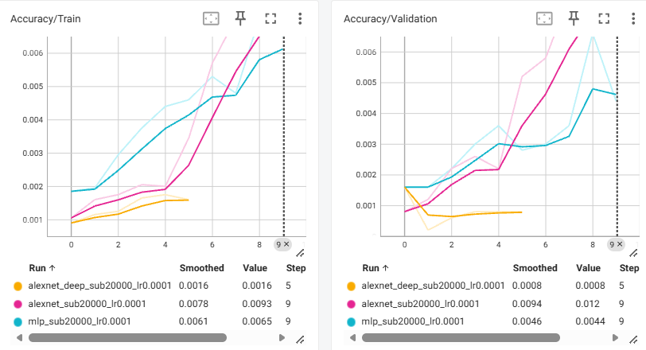
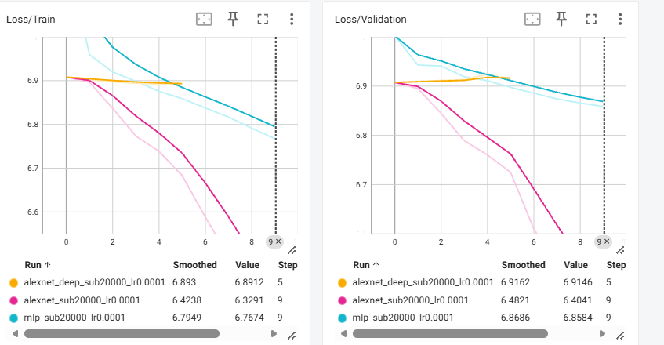

**Réponse : c'est du sous-apprentissage (underfitting), pas du surapprentissage.**
 
Ce que montrent les courbes :
 
- La loss d'entraînement reste presque bloquée à ln(1000) ≈ 6,908 (de 6,907 à 6,891 en 5 époques). Le réseau donne à peu près la même probabilité (1/1000) à toutes les classes.
- La loss de validation ne baisse pas du tout : elle monte même un peu (6,907 → 6,915).
- L'accuracy est au niveau du hasard (0,001) : 0,0016 en train et 0,0008 en validation.
- L'écart entre Train Loss et Val Loss est minuscule (0,023). Le surapprentissage demande une loss d'entraînement **basse** avec une loss de validation qui **remonte**. Ici, même la loss d'entraînement est haute : le modèle n'arrive pas à apprendre.
- Avec les mêmes données et les mêmes hyperparamètres, AlexNet (5 convolutions) apprend (Train Loss 6,33 et Val Acc 1,2 % à l'époque 9). Seule la profondeur change : 8 convolutions au lieu de 5.
- Le run s'arrête à l'époque 5 à cause de l'Early Stopping : la loss de validation n'a jamais fait mieux que celle de l'époque 0 pendant 5 époques de suite (patience = 5).
Explication :
 
- La rétropropagation applique la règle de la chaîne : le gradient d'une couche est un **produit** de termes, un par couche suivante. Avec plus de couches (et sans BatchNorm ni connexions résiduelles), ce produit a tendance à devenir très petit : c'est le **gradient qui s'évanouit** (*vanishing gradient*). Les premières couches ne se mettent presque pas à jour et le réseau reste bloqué sur un plateau.
- De même, à l'initialisation, le signal qui traverse 8 convolutions + ReLU devient faible et presque identique pour toutes les images. La sortie ne dépend presque pas de l'entrée, donc la loss reste à ln(1000).
- Ajouter des paramètres (+ 1 770 240) ne veut pas dire mieux apprendre : ici la profondeur rend l'**optimisation** plus difficile.

 

---

## Exercice 4 : Entraînement long avec sbatch

### Question 4.a – Lancement

- `train_imagenet.py` : sans arguments, il lance AlexNet avec `subset_size=None` et `num_epochs=50`.
- `run_imagenet.sh` : script Slurm fourni (1 GPU, 8 CPUs, 24 Go, 4 h, logs dans `logs/`).

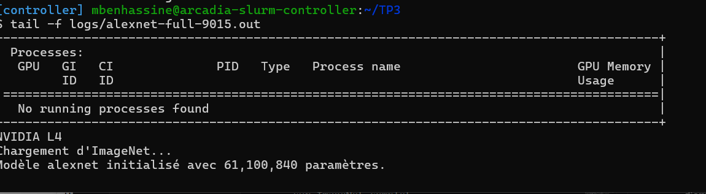
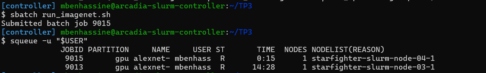
- **Nœud utilisé :** `starfighter-slurm-node-04-1`
- **GPU utilisé :** NVIDIA L4
- **Modèle :** AlexNet
###  1 – Profilage temporel et matériel
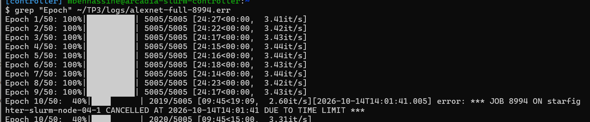
Durée d'une époque complète (1,28 M images) : environ 24 min 19 s, calculée à partir de la moyenne des 9 époques terminées du job 8994.

Durée estimée pour 100 époques :

Calcul :

100 × (24 × 60 + 19) / 3600 ≈ 40,53 heures

La durée estimée pour 100 époques est donc d'environ 40 h 32 min.

Remarque : le job 8994 a été interrompu pendant la 10e époque en raison de la limite de temps imposée par Slurm.

### 2 – Analyse de l'entraînement

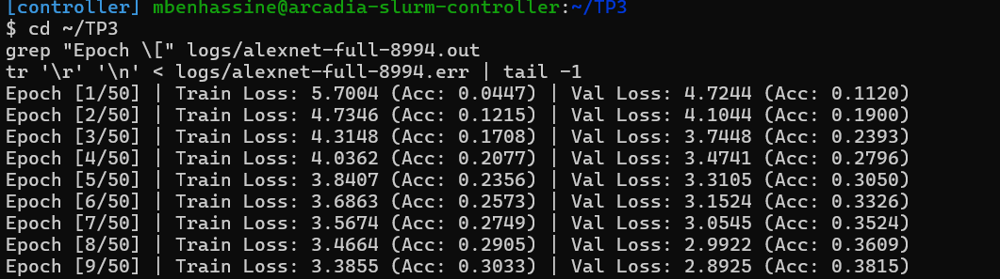

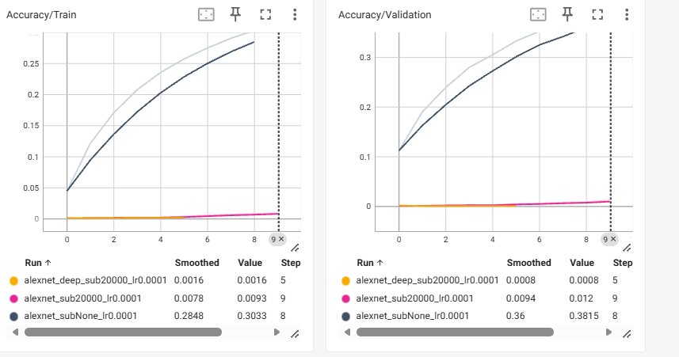

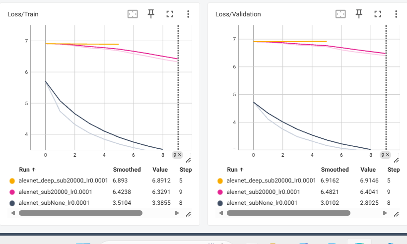

| Époque | Train Loss | Val Loss | Train Acc | Val Acc |
|---:|---:|---:|---:|---:|
| 1 | 5,7004 | 4,7244 | 4,47 % | 11,20 % |
| 2 | 4,7346 | 4,1044 | 12,15 % | 19,00 % |
| 3 | 4,3148 | 3,7448 | 17,08 % | 23,93 % |
| 4 | 4,0362 | 3,4741 | 20,77 % | 27,96 % |
| 5 | 3,8407 | 3,3105 | 23,56 % | 30,50 % |
| 6 | 3,6863 | 3,1524 | 25,73 % | 33,26 % |
| 7 | 3,5674 | 3,0545 | 27,49 % | 35,24 % |
| 8 | 3,4664 | 2,9922 | 29,05 % | 36,09 % |
| 9 | 3,3855 | 2,8925 | 30,33 % | 38,15 % |
 
La loss d'entraînement diminue progressivement de 5,7004 à 3,3855, tandis que la loss de validation passe de 4,7244 à 2,8925. En parallèle, les accuracies augmentent à chaque époque. Le modèle améliore donc ses performances sur les données d'entraînement et de validation.
 
L'accuracy de validation atteint 38,15 % à la neuvième époque, contre 30,33 % pour l'entraînement. La loss de validation reste inférieure à la loss d'entraînement sur les neuf époques observées.
 
**Comparaison de l'écart Loss/Train – Loss/Validation avec l'exercice 3**
 
| Expérience | Train Loss | Val Loss | Écart (Val − Train) |
|---|---:|---:|---:|
| AlexNet, 20 000 images (10ᵉ époque, step 9) | 6,3291 | 6,4041 | +0,075 |
| AlexNet, ImageNet complet (9ᵉ époque, step 8) | 3,3855 | 2,8925 | −0,493 |
 
Sur 20 000 images, la loss de validation est **au-dessus** de la loss d'entraînement (+0,075) : le modèle est un peu meilleur sur les images qu'il a déjà vues que sur les nouvelles. C'est le début d'un écart de généralisation, qui grandirait avec plus d'époques. Sur nos 10 époques, le modèle apprend encore à peine (loss proche de ln(1000) ≈ 6,91). Sur ImageNet complet, l'écart est **négatif** (−0,976 à l'époque 1, −0,493 à l'époque 9) : la validation est meilleure que l'entraînement, donc il n'y a pas de surapprentissage visible.
 
**Pourquoi le surapprentissage est-il beaucoup plus faible ici ?**
 
- **Beaucoup plus de données :** 1,28 million d'images contre 20 000 (64 fois plus). Le modèle voit beaucoup plus d'exemples différents et apprend des caractéristiques générales.
- **Rapport paramètres / exemples :** AlexNet a 61,1 millions de paramètres, soit environ 3055 paramètres par image avec 20 000 images, mais seulement environ 48 avec ImageNet complet. Avec 20 000 images, le modèle peut mémoriser le jeu d'entraînement. Avec 1,28 million d'images, c'est beaucoup plus difficile.
- **Data augmentation et dropout :** `RandomResizedCrop`, `RandomHorizontalFlip` et le Dropout (p = 0,5) limitent la mémorisation. Ils étaient aussi actifs à l'exercice 3, donc ils n'expliquent pas la différence entre les deux expériences. Ils expliquent surtout pourquoi la loss de validation est plus basse que celle d'entraînement (partie suivante).
Sur les neuf époques, la loss de validation continue de baisser et l'accuracy de validation de monter : aucun signe évident de surapprentissage. L'entraînement s'est arrêté à l'époque 9 à cause de la limite de 4 h du job, donc on ne voit pas la suite.
 
### 3 – Observation surprenante : pourquoi la Loss/Validation est plus basse que la Loss/Train ?
 
Dans nos logs, la loss de validation est plus basse que la loss d'entraînement à chacune des 9 époques (par exemple 4,72 contre 5,70 à l'époque 1, et 2,89 contre 3,39 à l'époque 9). Deux raisons liées à notre code :
 
1. **Le Dropout :** il est **actif** pendant l'entraînement (`model.train()`), donc le réseau travaille avec la moitié des neurones des couches denses (p = 0,5), ce qui rend ses prédictions moins bonnes. En validation (`model.eval()`), il est **désactivé** et le réseau complet donne de meilleures prédictions.
2. **La data augmentation :** les images d'entraînement sont déformées (`RandomResizedCrop`, `RandomHorizontalFlip`), donc plus difficiles. Les images de validation sont simples (`Resize(256)` + `CenterCrop(227)`, objet au centre), donc plus faciles.
Remarque en plus : la Loss/Train est une **moyenne sur toute l'époque**, calculée pendant que le modèle progresse. La Loss/Validation est calculée **à la fin** de l'époque avec le modèle le plus à jour.

