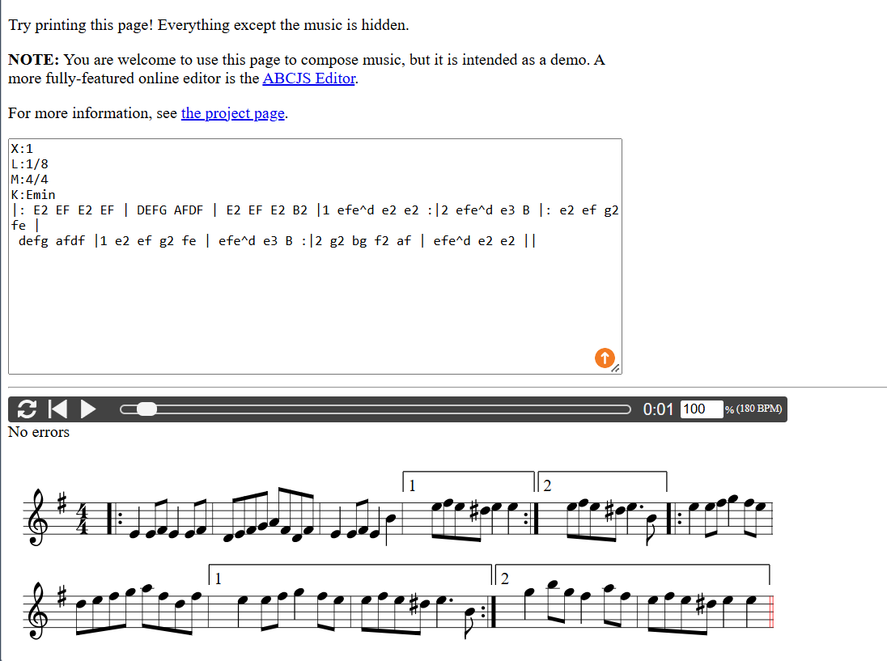
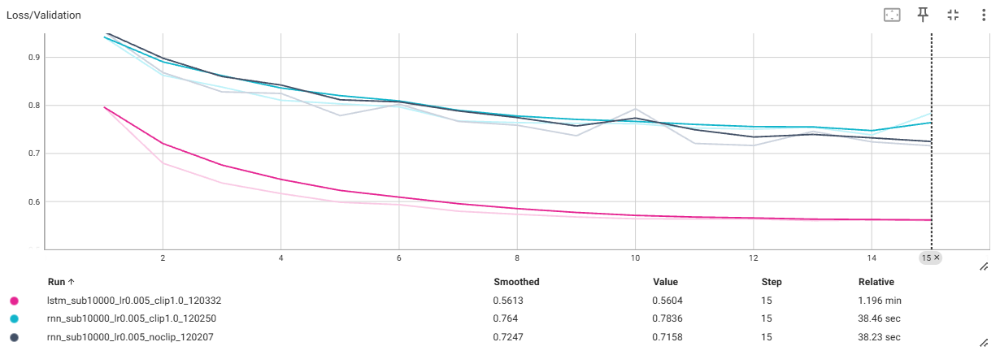
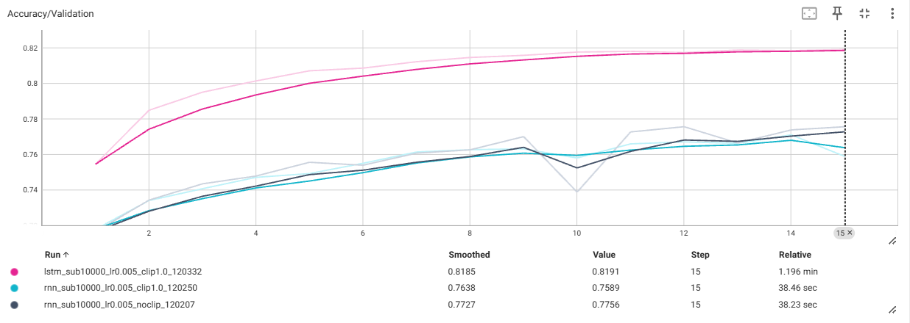
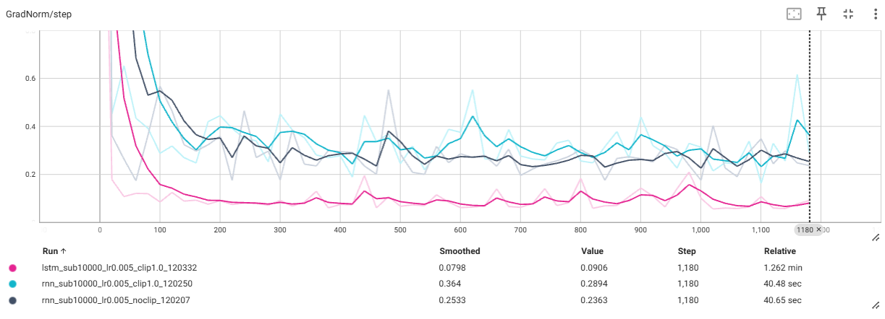
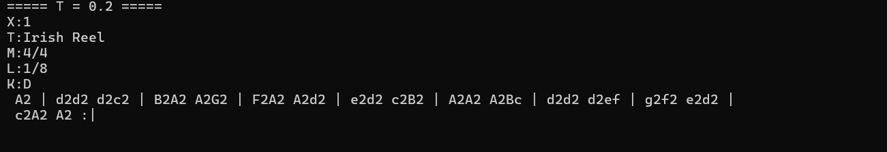
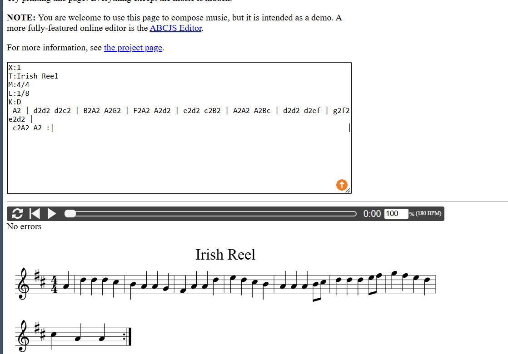
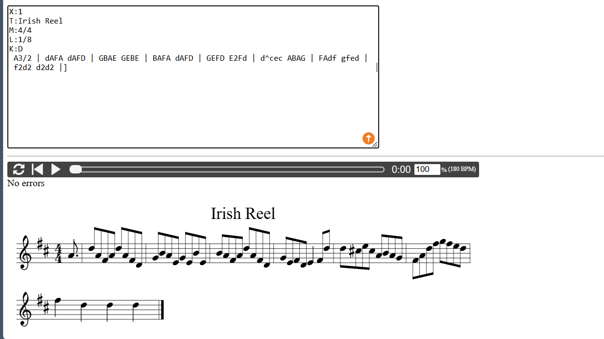
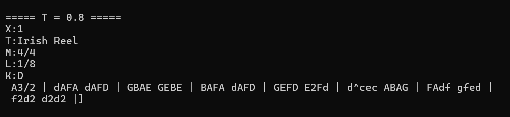
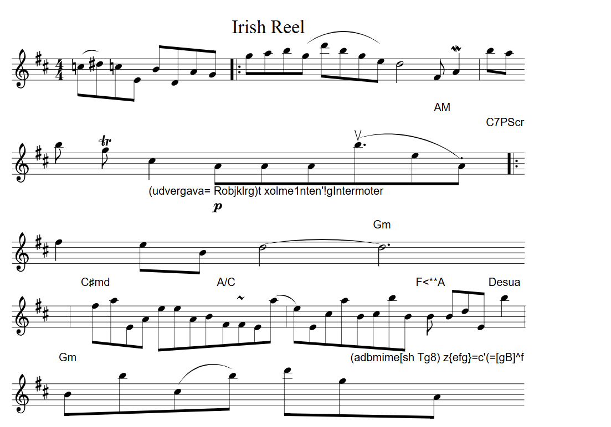

# TP4 : Réseaux récurrents et génération de séquences

**Auteur :** Mabahej

---

## Exercice 1

### Étape 1 : Chargement et découverte du jeu de données

**Question 1 : Nombre de partitions**

- `train.json` : **214 122** partitions
- `validation.json` : **2 162** partitions

**Question 2 : Première partition et rôle des en-têtes**

```abc
X:1
L:1/8
M:4/4
K:Emin
|: E2 EF E2 EF | DEFG AFDF | E2 EF E2 B2 |1 efe^d e2 e2 :|2 efe^d e3 B |: e2 ef g2 fe |
 defg afdf |1 e2 ef g2 fe | efe^d e3 B :|2 g2 bg f2 af | efe^d e2 e2 ||
```



- **`X:1`** : numéro de référence du morceau.
- **`L:1/8`** : durée de note par défaut (croche). `E2` vaut deux croches.
- **`M:4/4`** : métrique, quatre temps par mesure, ce qui fixe le placement des barres de mesure.
- **`K:Emin`** : tonalité (mi mineur), donc les altérations de l'armure. C'est le dernier champ de l'en-tête : les notes commencent après.

### Étape 2 : Construction du vocabulaire et padding

**Question 1 : Vocabulaire et longueurs**

| Mesure | Valeur |
|--------|--------|
| `vocab_size` | **95** caractères uniques |
| Longueur moyenne (train) | **290,1** |
| Longueur maximale (train) | **2 968** |

**Question 2 : Pourquoi `sorted(...)` ?**

Un `set` n'a pas d'ordre fixe : son ordre d'itération peut changer d'une exécution à l'autre. Sans `sorted()`, `char_to_index` pourrait donc être différent à chaque lancement.

Or les poids du modèle sont liés à ces indices (couche `Embedding` et couche de sortie). Si un même indice correspond demain à un autre caractère, les prédictions sont mal décodées et la musique générée est incohérente. Avec `sorted()`, le mapping est stable et les poids sauvegardés restent utilisables.

**Question 3 : Pourquoi 500 et non `max_len` ?**

`max_len` (2 968) vaut environ dix fois la longueur moyenne (290). Un padding jusqu'à `max_len` aurait trois effets :

- **Temps de calcul** : le RNN/LSTM traite chaque pas de temps, donc la majorité du calcul porterait sur du padding inutile.
- **Mémoire GPU** : les activations stockées croissent avec `seq_len`, ce qui oblige à réduire le `batch_size`.
- **Apprentissage** : trop de padding dilue le signal musical, et les longues séquences aggravent l'instabilité des gradients.

500 est un compromis : seules 6,9 % des partitions (14 697 sur 214 122) sont tronquées.

---

## Exercice 2

### Étape 1 : Création du `MusicDataset`

**Question 1 : Dimensions des tenseurs et type `torch.long`**

Avec `SEQ_LENGTH = 500` et `BATCH_SIZE = 128` :

```
x : (128, 499)  torch.int64
y : (128, 499)  torch.int64
```

Le décalage d'un cran retire un caractère : 500 − 1 = 499.

On utilise `torch.long` car les valeurs sont des indices de caractères (des entiers). `nn.Embedding` s'en sert pour sélectionner une ligne de sa table, et `CrossEntropyLoss` attend des classes cibles entières. Un `float32` ne peut pas servir d'indice.

### Étape 2 : Architecture récurrente (RNN vs LSTM)

**Question 1 : Nombre de paramètres**

`vocab_size = 95`, `embedding_dim = 256`, `hidden_size = 512` :

- Embedding : `95 × 256 = 24 320`
- RNN : `512×256 + 512×512 + 512 + 512 = 394 240`
- LSTM : `4 × 394 240 = 1 576 960`
- fc : `512 × 95 + 95 = 48 735`

| Couche | RNN | LSTM |
|--------|-----|------|
| Embedding | 24 320 | 24 320 |
| Récurrente | 394 240 | 1 576 960 |
| fc | 48 735 | 48 735 |
| **Total** | **467 295** | **1 650 015** |

Ces valeurs correspondent exactement à `count_parameters`.

Le LSTM a 4 fois plus de paramètres car il calcule quatre transformations (porte d'entrée, porte d'oubli, candidat de cellule, porte de sortie), chacune de même taille que l'unique transformation du RNN (`W_ih`, `W_hh`, `b_ih`, `b_hh`).

**Question 2 : Embedding plutôt que couche linéaire sur l'indice**

Un `Linear(1 → embedding_dim)` sur l'indice impose un ordre numérique artificiel (5 serait « proche » de 6) et calcule `i·w + b`, donc tous les vecteurs seraient alignés sur une droite. `nn.Embedding` donne à chaque caractère son propre vecteur appris, indépendant des autres, ce qui permet de représenter des relations utiles. C'est équivalent à un `Linear` sur un vecteur one-hot, mais sans la multiplication par les 95 valeurs.

**Question 3 : Structure de `hidden_state`**

- `nn.RNN` renvoie un seul tenseur `h_n`, de forme `(1, batch, hidden_size)`.
- `nn.LSTM` renvoie un tuple `(h_n, c_n)`, chacun de forme `(1, batch, hidden_size)`.

Rôle des deux états du LSTM :

- `h_n` (état caché) : sortie de la cellule, transmise à la couche suivante et au pas de temps suivant.
- `c_n` (état de cellule) : mémoire à long terme, modifiée de façon additive par les portes d'oubli et d'entrée, ce qui permet au gradient de se propager sur de nombreux pas.

---

## Exercice 3

**Question 1 : Pourquoi `reshape(-1, vocab_size)` et `reshape(-1)` ?**

`CrossEntropyLoss` attend des logits `(N, C)` et des cibles `(N,)`. Les logits sont en 3D `(batch, seq, vocab)` : on fusionne batch et temps pour que chaque caractère prédit soit un échantillon. Le `-1` vaut `batch_size × (seq_len − 1) = 128 × 499 = 63 872` prédictions par batch.

**Question 2 : Ordre `backward` → `clip_grad_norm_` → `step`**

`loss.backward()` calcule les gradients : avant, il n'y a rien à écrêter. `optimizer.step()` utilise les gradients pour mettre à jour les poids : le clipping doit donc avoir lieu avant, sinon il n'a aucun effet sur la mise à jour.

**Question 3 : Analyse expérimentale (TensorBoard)**

Rose = Run 3 (LSTM, clip 1.0), cyan = Run 2 (RNN, clip 1.0), gris foncé = Run 1 (RNN, sans clipping).

**Loss/Validation**



**Accuracy/Validation**



**GradNorm/step**



*Run 1 contre Run 2 :*

- Dans les deux runs, la norme du gradient chute après les premiers pas, puis oscille entre environ 0,2 et 0,4. Elle reste sous 1,0, et la valeur enregistrée est celle avant clipping : le clipping n'est presque jamais déclenché.
- Les pertes sont proches et bruitées (Val Loss finale 0,7158 pour le Run 1 contre 0,7836 pour le Run 2) : l'écart vient du bruit d'une époque à l'autre, pas du clipping.
- Le clipping corrige en théorie l'**exploding gradient** du RNN simple (produit répété de `W_hh` sur 500 pas). Ici l'explosion ne s'est pas produite : le clipping reste un garde-fou.

*Run 2 contre Run 3 :*

- **Convergence** : le LSTM est bien plus rapide. Dès l'époque 2, sa Val Loss (0,679) est meilleure que celle du RNN après 15 époques.
- **Performances finales** : Val Loss 0,5604 contre 0,7836, et Val Acc 81,9 % contre 75,9 %.
- **Explication mathématique** : dans le RNN, `h_t = tanh(W_hh h_{t-1} + W_ih x_t + b)`, donc `∂h_t/∂h_{t-1} = diag(1 − h_t²) · W_hh`. Sur `T` pas, le gradient est un produit de `T` telles matrices : il s'évanouit (ou explose) exponentiellement. Dans le LSTM, l'état de cellule est mis à jour de façon additive :

  `c_t = f_t ⊙ c_{t-1} + i_t ⊙ g_t`

  avec `f_t` la porte d'oubli, `i_t` la porte d'entrée et `g_t` le candidat. On a `∂c_t/∂c_{t-1} = diag(f_t)`, sans multiplication par `W_hh`. Si `f_t ≈ 1`, le gradient traverse de nombreux pas presque intact : le LSTM conserve des informations à long terme (tonalité, métrique, reprises).

**Question 4 : Biais de l'Accuracy dû au padding**

Une partition de 250 caractères est complétée par 250 espaces. Prédire un espace après un espace est trivial et appris très vite : la moitié des cibles est facile, ce qui gonfle l'accuracy. On corrige avec `nn.CrossEntropyLoss(ignore_index=char_to_index[" "])` (et le même masque pour l'accuracy). Limite : cela ignore aussi les vrais espaces de la partition.

---

## Exercice 4

### Étape 1 : Génération avec propagation de l'état caché

**Question 1 : Efficacité algorithmique**

- **Sans `hidden_state`** : à l'itération `t`, on retraite les `t` premiers caractères. Le total est `1 + 2 + … + N`, soit **O(N²)**.
- **Avec `hidden_state`** : un seul caractère est traité par itération, soit **O(P + N)** (`P` = longueur de l'amorce).

**Question 2 : Rôle de la température**

- **`T → 0⁺`** : le logit maximal domine, `softmax` tend vers une distribution one-hot sur l'`argmax`. C'est le **décodage glouton (greedy)** : déterministe, risque de boucles répétitives.
- **`T → +∞`** : `z/T → 0`, `softmax` tend vers la **distribution uniforme** (1/95 par caractère) : tirage aléatoire sans structure.

**Question 3 : Écoute et analyse qualitative**

Amorce : `"X:1\nT:Irish Reel\nM:4/4\nL:1/8\nK:D\n"`, 300 caractères générés par le meilleur LSTM.

**T = 0,2**

```abc
X:1
T:Irish Reel
M:4/4
L:1/8
K:D
A2 | d2d2 d2c2 | B2A2 A2G2 | F2A2 A2d2 | e2d2 c2B2 | A2A2 A2Bc | d2d2 d2ef | g2f2 e2d2 |
c2A2 A2 :|
```




Syntaxe valide (mesures complètes, notes ABC correctes, reprise `:|` finale). La mélodie est simple et monotone (surtout des noires, mouvement par degrés conjoints). Peu de diversité, ce qui est typique d'une basse température.

**T = 0,8**

```abc
X:1
T:Irish Reel
M:4/4
L:1/8
K:D
A3/2 | dAFA dAFD | GBAE GEBE | BAFA dAFD | GEFD E2Fd | d^cec ABAG | FAdf gfed |
f2d2 d2d2 |]
```




Syntaxe valide : chaque mesure contient 8 croches, avec une altération (`^c`) et un `|]` final. Le rythme est varié et certains motifs reviennent en évoluant (`dAFA dAFD`). C'est le meilleur compromis entre cohérence et diversité.

**T = 2,0**

```abc
X:1
T:Irish Reel
M:4/4
L:1/8
K:D
(=c^d)=cE BDAG |: gab(g d'bge) d4"_AM"F:>)M:A2| ba.
b ^Tg"_(udvergava= Robjklrg)t xolme1nten'!gIntermoter" c2!p!AAA2<(uble.A)"C7PScr" |:"Em"
f2eB d4-"Gm" d6!40] |"C#md" faEA keeAB"A/CE"FRFEa- | eEcaBcbB"F<**A" BBdE"Desua" b2 |
"Gm"Bb(cb) d'g" (adbmime[sh Tg8) z{efg}=c'(=[gB]^f/ |{f} g3^f)(gE)"A#
```



Syntaxe invalide : guillemets et parenthèses non refermés, pseudo-mots et accords inventés, mesures de longueurs incohérentes. Aucune structure musicale : c'est du chaos.

### Étape 2 : Entraînement à plus grande échelle (`sbatch run_music.sh`)

LSTM avec `hidden_size=1024`, `subset_size=50000`, `max_grad_norm=1.0`, `num_epochs=30`, `patience=5`.

- Meilleure Val Loss : **0,4893** (époque 15), Val Acc : **84,11 %**.
- La perte remonte aux époques 16 à 20 : l'Early Stopping s'arrête à l'époque 20 et le modèle de l'époque 15 est utilisé pour la génération.
- Amélioration par rapport au Run 3 (Val Loss 0,5604, Val Acc 81,91 %).

### Bonus : augmentation de données par transposition

On décale chaque note de `k` degrés de la gamme (`A→B→C…`, avec gestion des octaves : majuscules/minuscules, `,` et `'`) et on modifie `K:` en conséquence (`K:D` devient `K:E` pour un ton). On peut le faire au hasard dans `__getitem__`, avec `abc2abc -t` ou un parseur ABC.

Cela réduit le sur-apprentissage : une même mélodie apparaît dans plusieurs tonalités, donc le jeu de données effectif est plus varié et le modèle apprend des motifs mélodiques relatifs plutôt que de mémoriser les notes absolues de chaque morceau.