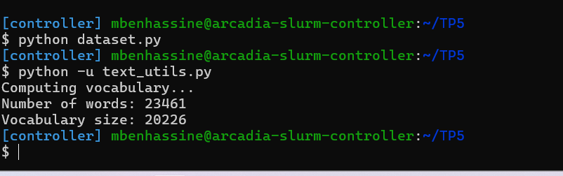
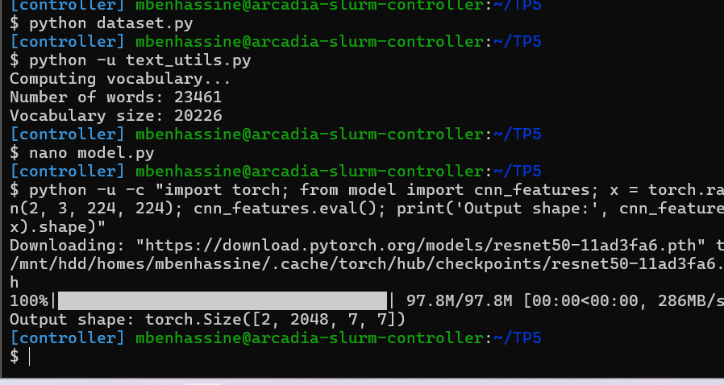
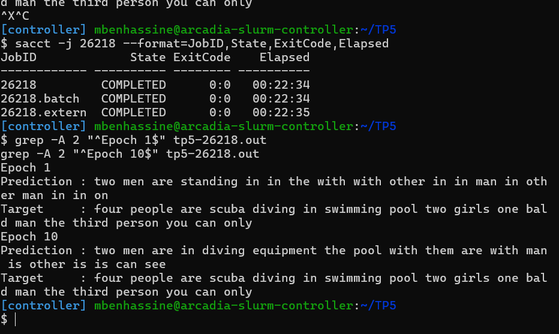
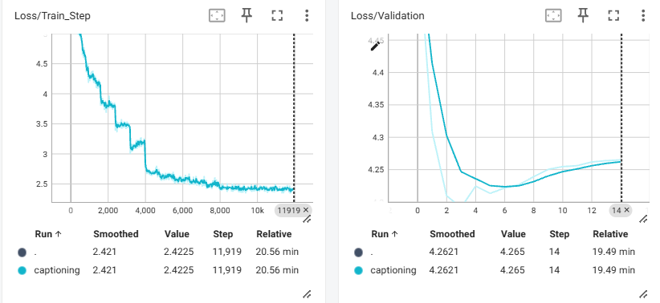
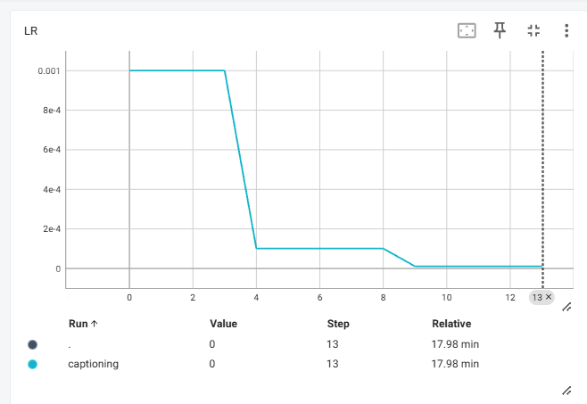

# TP5 — Image Captioning avec RNN et Attention sur ResNet

## Exercice 1 — Chargement des données et Embeddings

Les images du dataset Flickr30k sont redimensionnées en 224 × 224 pixels puis normalisées pour être compatibles avec ResNet50. Les données sont réparties en 80 % pour l'entraînement et 20 % pour le test.

**Pourquoi doit-on redimensionner toutes les images en (224, 224) ?**

Le redimensionnement permet d'obtenir des images de dimensions identiques pour former les batches et d'utiliser ResNet50 dans des conditions compatibles avec son pré-entraînement. Il permet également de maîtriser le coût des calculs.

**Capture du chargement des données :**

## Exercice 2 — Extraction de caractéristiques et Transfer Learning

**Pourquoi faut-il geler les poids de ResNet ? Donnez deux raisons.**

- **Raison matérielle :** cela réduit les calculs et l'utilisation de la mémoire pendant l'entraînement.
- **Raison algorithmique :** cela conserve les caractéristiques déjà apprises sur ImageNet et limite le surapprentissage.

**Quelle est la forme exacte de la sortie pour une entrée (32, 3, 224, 224) ?**

Pour une entrée de forme (32, 3, 224, 224), la sortie du réseau d'extraction de caractéristiques est (32, 2048, 7, 7).

Les 32 images sont représentées par 2048 cartes de caractéristiques de dimensions spatiales 7 × 7.

Dans la capture, le test a été effectué sur deux images, ce qui explique la sortie (2, 2048, 7, 7). Les autres dimensions restent identiques.
**Capture de la forme du tenseur :**

## Exercice 3 — Module d'Attention et LSTM Personnalisé

**À quoi correspond le `context_vector` ? Quel problème du Seq2Seq de base résout-il ?**

Le `context_vector` contient les informations des régions de l'image les plus utiles pour prédire le mot suivant. Il évite d'utiliser toujours un seul vecteur fixe pour représenter toute l'image.

## Exercice 4 — Modèle Global et Boucle d'Entraînement

Nous combinons ResNet50, les embeddings Word2Vec, le module d'attention et le LSTM pour générer des légendes.

**Paramètres d'entraînement :**

- Optimiseur : Adam
- Learning rate initial : 0.001
- Scheduler : StepLR (`step_size=5`, `gamma=0.1`)
- Nombre d'époques : 15

### Comparaison des prédictions

**Que remarque-t-on sur la syntaxe et la cohérence ? La légende s'améliore-t-elle ?**

À l'époque 1, la légende générée est peu cohérente et contient de nombreuses répétitions, notamment des mots comme « in », « man » et « other ».

À l'époque 10, la prédiction devient plus compréhensible. Le modèle génère notamment « two men are in diving equipment », ce qui correspond davantage à la scène de plongée décrite dans la légende de référence.

On observe donc une amélioration de la cohérence et de la pertinence des mots générés. Cependant, la phrase reste grammaticalement incorrecte et comporte encore des répétitions. Le modèle identifie mieux le contexte de l'image, mais la qualité de la légende reste limitée.

### Analyse du learning rate

**Quel est l'impact de StepLR ?**

StepLR réduit le learning rate tous les 5 epochs. Le modèle fait donc des mises à jour plus petites en fin d'entraînement, ce qui aide à stabiliser l'apprentissage.

**Que se passerait-il si on gardait `lr = 0.001` jusqu'à la fin ?**

Les mises à jour resteraient plus grandes. Le modèle pourrait osciller autour d'une bonne solution et avoir plus de mal à se stabiliser.

**Pourquoi réduire le learning rate avec Adam ou d'autres optimiseurs utilisant le momentum ou RMSProp ?**

Même avec Adam, les paramètres continuent d'être mis à jour. Réduire le learning rate permet d'affiner les poids plus doucement à la fin de l'entraînement.

### Visualisation TensorBoard

**Évolution des losses :**
L'entraînement du modèle de génération de descriptions d'images a été réalisé sur 15 époques. Les métriques ont été enregistrées et visualisées avec TensorBoard.

Évolution de la perte d'entraînement : La fonction de perte diminue progressivement pour atteindre environ 2,42 à la fin de l'entraînement. Cette diminution indique que le modèle apprend à prédire les mots des descriptions à partir des caractéristiques visuelles extraites des images.

Évolution de la perte de validation : La perte de validation diminue pendant les premières époques, atteignant un minimum d'environ 4,22 vers la cinquième ou sixième époque. Elle augmente ensuite légèrement jusqu'à environ 4,27. Cette évolution suggère un début de surapprentissage : le modèle continue de s'améliorer sur les données d'entraînement, mais ses performances sur les données de validation ne progressent plus.

**Évolution du learning rate :**

Le taux d'apprentissage est initialement fixé à 0,001. Avec le scheduler StepLR(step_size=5, gamma=0.1), il est divisé par 10 toutes les cinq époques, passant à 0,0001 puis à 0,00001.

La courbe TensorBoard montre clairement ces diminutions successives. La réduction du taux d'apprentissage permet d'effectuer des mises à jour plus petites des paramètres et de stabiliser l'entraînement.

Conclusion : Les courbes montrent que l'entraînement converge sur les données d'apprentissage. Cependant, la remontée de la perte de validation suggère qu'un arrêt anticipé (early stopping) ou la conservation du meilleur modèle sur validation pourrait améliorer la généralisation.

## Conclusion

Ce TP nous a permis de combiner un CNN pré-entraîné avec un LSTM et un mécanisme d'attention pour générer des descriptions d'images. Nous avons aussi étudié l'intérêt du transfer learning et de la réduction du learning rate.
