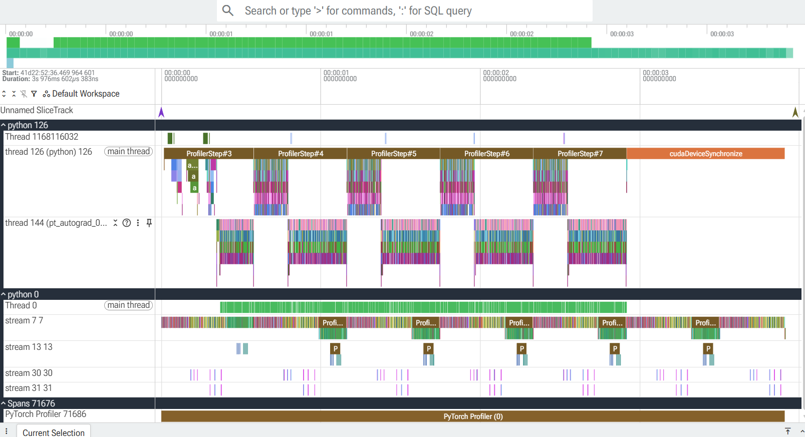
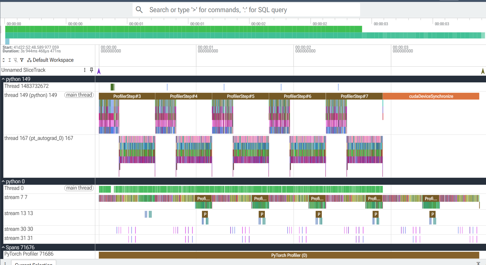

# TP6 — Accélérer un ResNet-50

**CSC8607 — Deep Learning**

## Exercice 0 — Environnement

**Sortie de `check_env.py` (job 54880, `ex0.sh`, nœud `arcadia-slurm-node-2`) :**

```text
Machine        : arcadia-slurm-node-2
Python         : 3.10.21
torch          : 2.13.0+cu132 (CUDA 13.2)
torchvision    : 0.28.0+cu132
torchao        : 0.18.0
CPU alloués    : 4  (x86_64)
Drapeaux CPU   : avx512f, avx512_vnni, avx512_bf16
gcc            : /usr/bin/gcc
GPU            : NVIDIA H100 NVL
Mémoire GPU    : 95321 Mio au total, 94795 Mio libres
bf16 supporté  : True
Données raw    : /mnt/ssd/imagenet/2012 -> (12894, 500) images (train, val)
Données small  : /tmp/mbenhassine/tp6/imagenet10_256 -> (12894, 500) images (train, val)
Poids ResNet-50 pré-entraînés : OK
```

**Remarques :** versions installées : torch 2.13.0 et torchvision 0.28.0 (le sujet indique 2.14.1 et 0.29.2). Ce job a reçu un H100 NVL entier (95 321 Mio), alors que les mesures de `results_bench.csv` ont été faites sur une instance MIG 1g.12gb (≈ 1/7 de H100).

**Effet attendu des 4 CPU :** on dispose de 4 cœurs pour alimenter un septième de H100. Un des cœurs est réservé au processus principal (lancement des noyaux, copies, boucle d'entraînement), il en reste donc environ 3 pour les workers du `DataLoader`, qui lisent, décodent les JPEG et appliquent les transformations (`RandomResizedCrop`, normalisation). Cette limite ne pose pas de problème tant que le GPU est lent : en FP32, il consomme environ 110 images/s. Elle devient en revanche le goulot dès que le calcul s'accélère (BF16, `channels_last`, `torch.compile`), car il faut alors fournir plusieurs centaines d'images/s avec seulement ~3 workers. On anticipe donc que le chargement limitera le débit après optimisation, et que les images `small`, moins coûteuses à décoder, seront utiles.
## Exercice 1 — Mesure de référence

### 1. Débit, mémoire et durée d'une époque

| Configuration | Débit (images/s) | Pic mémoire (Go) | Époque (s) |
|---|---:|---:|---:|
| `ref-synth` (FP32, synthétique) | 110,1 | 5,93 | Non mesurée |
| `ref-raw` (FP32, JPEG, 3 workers) | 109,9 | 5,93 | 117,3 |

### 2. Estimation de la mémoire de `ref-synth`

Pour 23,5 millions de paramètres FP32, un batch de 64 et 84 Mo d'activations par image (approximation du cours) :

- Paramètres : $23,5 \times 4 = 94$ Mo ; gradients : 94 Mo.
- États AdamW : $2 \times 94 = 188$ Mo.
- Activations : $64 \times 84 = 5\,376$ Mo.

Total estimé : **5 752 Mo = 5,752 Go**. Le pic mesuré est de **5,93 Go**, soit un écart de **0,178 Go (environ 3,1 %)**, explicable notamment par les buffers temporaires, les espaces de travail CUDA et les tenseurs non comptés dans cette approximation.

### 3. Mesure asynchrone

```text
[ref-async] retour de l'appel : 13.1 ms ; fin réelle du pas : 582.8 ms
```

Le CPU rend la main après le lancement des opérations, tandis que le GPU continue à les exécuter. Sans `torch.cuda.synchronize()`, le chronométrage sous-estime donc le temps du pas complet.

### 4. Batch maximal FP32

`results_maxbatch.csv` indique **120 images**, conformément à l'ordre de grandeur annoncé dans le cours. Les erreurs OOM rencontrées pendant la recherche sont attendues.

### 5. Comparaison des débits

`ref-raw` (109,9 images/s) est seulement **0,18 %** plus lent que `ref-synth` (110,1 images/s). Avec 3 workers et `pin_memory=True`, le chargement des images ne semble donc pas limiter significativement cette configuration FP32.

## Exercice 2 — Chargement des données et profilage

### 1. Débits mesurés

| Configuration | Données | Workers | `pin_memory` | Débit (images/s) |
|---|---|---:|---|---:|
| `raw-w0` | Raw | 0 | Oui | 83,6 |
| `raw-w1` | Raw | 1 | Oui | 109,9 |
| `raw-w2` | Raw | 2 | Oui | 109,8 |
| `raw-w3` | Raw | 3 | Oui | 109,8 |
| `raw-w3-nopin` | Raw | 3 | Non | 107,8 |
| `small-w0` | Small | 0 | Oui | 93,0 |
| `small-w3` | Small | 3 | Oui | 109,8 |

### 2. Effet du nombre de workers

Le débit raw augmente de **83,6** à **109,9 images/s** entre 0 et 1 worker, puis plafonne à environ **109,8 images/s**. Avec `--cpus-per-task=4`, il faut aussi réserver du temps CPU au processus principal ; au-delà de 3 workers, la contention risque d'annuler le bénéfice. Ce n'est pas une limite technique stricte du `DataLoader`, mais une limite pratique de cette allocation.

### 3. Effet de `pin_memory`

À 3 workers, le débit passe de **107,8** à **109,8 images/s** avec `pin_memory=True`, soit **+1,9 %**. Cette option place les données en mémoire hôte verrouillée, ce qui facilite les transferts CPU–GPU, notamment avec `non_blocking=True`.

### 4. Images `small` et `raw`

Sans worker, `small-w0` atteint **93,0 images/s** contre **83,6** pour `raw-w0` : les JPEG redimensionnés demandent moins de lecture et de décodage. Les transformations produisent des entrées de taille identique (224 × 224), mais les fichiers sources redimensionnés peuvent avoir perdu certains détails : les pixels ne sont pas nécessairement identiques. Avec 3 workers, les deux sources atteignent **109,8 images/s**.

### 5. Estimation du temps de décodage

Avec la formule de l'énoncé $t_d \approx 1/D_{w0}-1/D_{synth}$ et $D_{synth}=110,1$ images/s :

| Source | Estimation $t_d$ | Capacité estimée d'un worker | Seuil théorique avec 3 workers |
|---|---:|---:|---:|
| Raw | $1/83,6-1/110,1 \approx 2,88$ ms/image | 347 images/s | 1 042 images/s |
| Small | $1/93,0-1/110,1 \approx 1,67$ ms/image | 599 images/s | 1 796 images/s |

Au-delà de ces seuils théoriques, 3 workers ne suffiraient plus à alimenter le GPU. Cette estimation simplifiée inclut le coût supplémentaire de préparation/chargement et suppose un parallélisme idéal ; elle ne constitue pas une mesure isolée du seul décodage JPEG.

### 6. Traces Perfetto

**Raw, 3 workers :**



La trace montre cinq itérations (`ProfilerStep#3` à `#7`), un flux CUDA dense et peu de longues périodes d'inactivité. `aten::convolution_backward` totalise **1,685 s** de temps CUDA cumulé (**43,14 %** du temps attribué aux opérations). Le profil est donc **principalement limité par le calcul**, plutôt que par les données ou le lancement.

**Small, 3 workers :**



Le flux CUDA est également occupé, avec peu de grands intervalles vides ; `aten::convolution_backward` totalise **1,684 s** (**43,16 %**). Le profil est aussi **principalement limité par le calcul**. Ces pourcentages sont des temps CUDA cumulés par opération, pas une fraction exclusive du temps écoulé.

### 7. Fraction du débit synthétique

La meilleure configuration de chargement est `raw-w1` : $109,9/110,1 \times 100 \approx$ **99,8 %** du débit synthétique. Le chargement n'est donc presque plus limitant dans ces conditions.

## Exercice 3 — BF16, `channels_last` et `torch.compile`

### 1. Mesures de `ex3.sh`

| Configuration | Données | Workers | Débit (img/s) | Pic mémoire (Go) | Compilation (s) |
|---|---|---:|---:|---:|---:|
| FP32 | Synthétiques | — | 109,8 | 5,93 | — |
| TF32 | Synthétiques | — | 261,4 | 5,93 | — |
| BF16 | Synthétiques | — | 383,7 | 3,29 | — |
| BF16 + CL | Synthétiques | — | 530,1 | 3,29 | — |
| BF16 + CL + compile | Synthétiques | — | 681,3 | 3,08 | 66,0 |
| BF16 + CL | Raw | 1 | 242,7 | 3,29 | — |
| BF16 + CL + compile | Raw | 1 | 155,6 | 3,07 | 10,1 |
| BF16 + CL | Raw | 3 | 525,2 | 3,29 | — |
| BF16 + CL + compile | Raw | 3 | 681,7 | 3,07 | 10,6 |
| BF16 + CL | Small | 1 | 471,8 | 3,29 | — |
| BF16 + CL + compile | Small | 1 | 338,2 | 3,07 | 13,0 |
| BF16 + CL | Small | 3 | 524,8 | 3,29 | — |
| BF16 + CL + compile | Small | 3 | 615,5 | 3,07 | 10,8 |

*CL = `channels_last`.*

### 2. Reproductibilité de la référence

`fp32-synthetic` = **109,8 images/s**, contre **110,1 images/s** pour `ref-synth`. L'écart relatif est $(109,8-110,1)/110,1 \times100 \approx$ **−0,27 %** : il est faible devant les gains des optimisations suivantes.

### 3. Gains successifs sur données synthétiques

| Optimisation | Calcul | Gain |
|---|---|---:|
| FP32 → TF32 | 261,4 / 109,8 | ×2,38 |
| TF32 → BF16 | 383,7 / 261,4 | ×1,47 |
| BF16 → BF16 + CL | 530,1 / 383,7 | ×1,38 |
| BF16 + CL → compile | 681,3 / 530,1 | ×1,29 |

TF32 exploite les **Tensor Cores** avec une précision interne réduite pour certains calculs FP32. BF16 diminue le trafic mémoire et permet également d'exploiter les Tensor Cores. `channels_last` favorise des noyaux de convolution efficaces ; `torch.compile` optimise et peut fusionner des opérations. Le gain total est **681,3 / 109,8 ≈ 6,20×**.
### 4. Données, dispersion et loi d'Amdahl

| Données | Workers | Sans compile (img/s) | Avec compile (img/s) | Effet de `compile` | Goulot |
|---|---:|---:|---:|---|---|
| Synthétiques | — | 530,1 | 681,3 | +28,5 % | calcul |
| Raw | 1 | 242,7 | 155,6 | aucun gain (−35,9 %, non significatif) | chargement |
| Raw | 3 | 525,2 | 681,7 | +29,8 % | calcul |
| Small | 1 | 471,8 | 338,2 | aucun gain (−28,3 %, non significatif) | chargement |
| Small | 3 | 524,8 | 615,5 | +17,3 % | mixte |

**`compile` n'apporte rien quand le chargement limite.** Il accélère le calcul GPU, pas le décodage JPEG : si le GPU attend ses batchs, le débit est fixé par les workers. Avec 1 worker, le GPU compilé attend davantage et les mesures sont dominées par le pipeline CPU. `compile` ne devient utile que lorsque le calcul est le goulot : raw avec 3 workers (+29,8 %, débit identique au synthétique compilé, 681,7 contre 681,3). Avec small et 3 workers, le gain est réduit (+17,3 %), car le chargement commence à limiter (615,5 contre 681,3, soit −9,7 %).

**Comparaison avec l'estimation de l'exercice 2.** Elle prévoyait qu'un worker ne suffirait pas à alimenter le GPU optimisé (347 img/s en raw, 599 en small, contre 530 img/s de calcul), ce qui se confirme. Mais elle est **optimiste** : avec 1 worker, on mesure 242,7 img/s en raw (70 % de 347) et 155,6 avec compile (45 %), 471,8 en small (79 % de 599) et 338,2 avec compile (56 %). L'estimation suppose un parallélisme idéal et ne tient pas compte du CPU que le processus principal consomme, ni du partage du nœud avec d'autres étudiants.

**Dispersion à 1 worker.** Les intervalles `img_s_min`–`img_s_max` sont **134,7–299,0** (raw sans compile), **149,2–175,1** (raw compilé), **442,0–496,4** (small sans compile) et **310,2–500,8** (small compilé). Ils se chevauchent entre « avec » et « sans » compile : on ne peut pas attribuer la baisse apparente à `compile` lui-même, car le pipeline CPU et la charge partagée varient. Selon la **loi d'Amdahl**, accélérer le calcul GPU ne suffit pas si le chargement reste la partie non accélérée : le gain global est borné par elle.

### 5. Nombre de workers sur un H100 entier

En supposant, pour un ordre de grandeur, qu'un H100 entier soit **7 fois** plus rapide qu'une instance MIG 1g.12gb : $7 \times 681,3 \approx$ **4 769 images/s**.

| Source | Workers (capacité de l'ex. 2) | Workers (extrapolation depuis la mesure à 1 worker compilé) |
|---|---:|---:|
| Raw | 4769 / 347 ≈ **14** | 4769 / 155,6 ≈ **31** |
| Small | 4769 / 599 ≈ **8** | 4769 / 338,2 ≈ **14** |

Il faut en plus un cœur pour le processus principal. **Avec les images raw, 30 cœurs sont à la limite et probablement insuffisants** : l'estimation idéale (14 workers) tient, mais l'extrapolation réaliste (31 workers + 1 cœur) dépasse les 30 cœurs. En pratique, le chargement raw limiterait un H100 entier. **Avec les images small, 30 cœurs suffisent** (8 à 14 workers). Si plusieurs GPU se partagent le nœud, même small deviendrait contraignant.

### 6. Compilation et amortissement

Les cinq temps mesurés sont **66,0 s** (synthétiques), puis **10,1 s**, **10,6 s**, **13,0 s** et **10,8 s** (raw/small). La première compilation est nettement plus longue ; la réutilisation de caches est une explication plausible, non directement isolée par ces mesures.

Sur données synthétiques, avec batch 64, le gain par pas vaut $64/530,1-64/681,3 \approx$ **0,02679 s**. Le seuil d'amortissement est donc :

- Sans réutilisation de cache : $66/0,02679 \approx$ **2 463 pas**.
- Avec un coût réduit à 10,6 s : $10,6/0,02679 \approx$ **396 pas**.

Deux époques correspondent à **402 pas**. La compilation initiale de 66 s n'est pas amortie ; avec un coût de 10,6 s, elle ne l'est que de justesse selon ce modèle simplifié.

### 7. Batch maximal

Le batch maximal est de **120** en FP32 et **240** en BF16, soit **2×**. Attention : `maxbatch-bf16` utilise aussi `channels_last`, alors que la référence FP32 ne l'utilise pas ; le rapport mesure donc l'effet combiné BF16 + `channels_last`, pas BF16 seul. Il reste cohérent avec la taille réduite de nombreux tenseurs BF16. Le rapport n'est pas exactement 2 en mémoire : à batch 64, le pic passe de 5,93 à 3,29 Go (×1,80), car certains éléments restent en FP32 (poids maîtres, états de l'optimiseur) et que des tampons temporaires subsistent.

### 8. Entraînement et validation

| Époque | Durée | Débit | Top-1 validation |
|---|---:|---:|---:|
| 0 | 72,9 s | 176,5 images/s | 99,0 % |
| 1 | 19,4 s | 662,5 images/s | 99,2 % |

La première époque est plus lente de **72,9 − 19,4 = 53,5 s**. Cet écart correspond à la compilation de `torch.compile` (qui s'exécute à la première itération, incluse dans le chronométrage de l'époque) et aux coûts de démarrage (remplissage des workers, initialisation CUDA et cuDNN). Il est cohérent avec les temps de compilation mesurés dans `ex3.sh` (10 à 66 s selon les cas).

Par rapport à `ref-raw` (109,9 images/s), la seconde époque est **662,5 / 109,9 ≈ 6,03×** plus rapide. Ce facteur reste **indicatif**, car `results_bench.csv` mentionne une instance H100 MIG, alors que `results_train.csv` indique « NVIDIA H100 NVL » : l'identité exacte des ressources GPU n'est pas confirmée par ces seuls libellés. Le meilleur checkpoint est `best.pth` (top-1 = 99,2 %).

## Exercice 4 — DDP sur deux NVIDIA L4

### 1. Transport et débit NCCL

Le journal `logs/nccl-54821.log` indique :

```text
NCCL INFO NET/IB : No device found.
NCCL INFO NET/Socket : Using [0]ens18:10.91.152.162
NCCL INFO NET/Socket : Using [0]ens18:10.91.152.161
NCCL INFO Using network Socket
all-reduce de 102 Mo sur 2 processus : 876.9 ms ;
débit algorithmique 0.12 Go/s ; débit par lien 0.12 Go/s
```

NCCL utilise donc **Socket** via `ens18`, et non InfiniBand. Les deux débits affichés sont de **0,12 Go/s**, soit **0,96 Gbit/s** après conversion de la valeur arrondie. Avec la taille exacte du tenseur (102,228 Mo) et la durée, le débit algorithmique vaut environ **0,93 Gbit/s**. Cela est compatible avec un lien Ethernet d'ordre de grandeur **1 Gbit/s**, sans prouver la vitesse nominale du matériel.

### 2. Six étapes de mesure (A à F)

| Étape / configuration | GPU | Accum. | Batch effectif | Temps/pas (ms) | Débit global (img/s) | Speedup vs 1 GPU | Efficacité |
|---|---:|---:|---:|---:|---:|---:|---:|
| A — all-reduce 102 Mo | 2 | — | — | — (communication : 876,9 ms) | — | — | — |
| B — `l4-x1` | 1 | 1 | 64 | 138,5 | 462,0 | 1,00× | 100 % (référence) |
| C — `l4-x2` | 2 | 1 | 128 | 867,0 | 147,6 | 0,32× | 16,0 % |
| D — `l4-x2-bf16hook` | 2 | 1 | 128 | 462,7 | 276,7 | 0,60× | 29,9 % |
| E — `l4-x1-accum8` | 1 | 8 | 512 | 1 053,3 | 486,1 | 1,00× | 100 % (référence) |
| F — `l4-x2-accum8-bf16hook` | 2 | 8 | 1 024 | 1 378,2 | 743,0 | 1,53× | 76,4 % |

Pour deux GPU, $S=D_2/D_1$ et $E=S/2$. Les comparaisons utilisent la référence **à un GPU de même accumulation** : B pour C/D, E pour F.

### 3. Coût de communication et recouvrement

Les gradients FP32 représentent environ $23,5\times10^6\times4=$ **94 Mo**. Le tenseur NCCL mesuré contient 25 557 032 éléments FP32, soit **102,228 Mo**. En supposant un coût proportionnel au volume :

$$
t_c \approx 876,9\times\frac{94}{102,228}=806,3\ \text{ms}.
$$

Avec $t_1=138,5$ ms (B) et $t_2=867,0$ ms (C) :

- Sans recouvrement : $t_1+t_c=944,8$ ms.
- Avec recouvrement parfait : $\max(t_1,t_c)=806,3$ ms.
- Durée masquée estimée : $t_{rec}=138,5+806,3-867,0=$ **77,8 ms**.

Le temps mesuré se situe entre les deux limites. Le recouvrement masque une partie de la communication, mais celle-ci reste le principal surcoût. Ces durées sont **des estimations**, car le test de communication est distinct de l'entraînement.

### 4. Effet de `--bf16-hook`

Sur deux L4, le temps par pas diminue de **867,0** à **462,7 ms**, et le débit augmente de **147,6** à **276,7 images/s**, soit **1,87×**. Le hook communique les gradients en BF16 plutôt qu'en FP32 : leur volume passe approximativement de 94 à 47 Mo. Le risque est une erreur d'arrondi supplémentaire pouvant affecter la convergence ; ce benchmark ne mesure pas cet effet sur la précision finale.

### 5. Amdahl et prédiction avec accumulation

La loi d'Amdahl classique ne tient pas compte du coût réseau ajouté par DDP, ni du changement de batch global. Pour prévoir F **sans utiliser sa mesure**, nous appliquons le modèle de l'énoncé avec $k=8$, $t_1=138,5$ ms et $t_{rec}=77,8$ ms. Avec le hook BF16, nous estimons $t_{c,BF16}\approx806,3/2=403,2$ ms :

$$
T_{2,\mathrm{prévu}}\approx8\times138,5+403,2-77,8=1433,4\ \text{ms}.
$$

La valeur mesurée est **1 378,2 ms**, soit un écart relatif d'environ **4,0 %**. Le modèle est donc cohérent à cet ordre de grandeur, mais repose sur une approximation du coût réseau et du recouvrement.

### 6. Condition de rentabilité du DDP multi-nœuds

Pour deux GPU, à batch par GPU et accumulation identiques, le DDP est rentable en débit global si $T_2<2T_1$. Dans le modèle simplifié, cela revient à $t_c-t_{rec}<k\,t_1$.

Sans optimisation, le débit sur deux GPU (**147,6 images/s**) est inférieur à celui d'un seul (**462,0**). Avec accumulation 8 et hook BF16, le débit passe de **486,1** à **743,0 images/s**, soit **1,53×**.

Deux leviers et leurs contreparties : **compression BF16**, qui réduit le trafic mais peut modifier les gradients ; **accumulation**, qui réduit la fréquence des synchronisations mais augmente le batch effectif et modifie la dynamique d'optimisation.

### 7. Taux d'apprentissage et batch effectif

Le batch effectif passe de **64** à **128**, puis **1 024** images. Avec **AdamW**, on peut conserver initialement le taux d'apprentissage et le régler expérimentalement, ou tester une croissance modérée (par exemple en $\sqrt{B}$) avec warm-up : il n'y a pas de règle universelle. Avec **SGD**, une règle courante est la mise à l'échelle linéaire avec le batch (×2 puis ×16 par rapport au batch 64), accompagnée d'un warm-up et d'une vérification de la convergence.

### 8. Graines, données et synchronisation

Les processus initialisent le même modèle (et DDP synchronise les paramètres initiaux) pour calculer des gradients compatibles. Ils utilisent des données différentes afin de répartir le travail. Dans la branche synthétique, chaque rang emploie `args.seed + rank` pour les données.

Dans la branche `small`, oublier `sampler.set_epoch(epoch)` ferait réutiliser le même ordre de mélange à chaque époque. Oublier `model.no_sync()` déclencherait un all-reduce à chaque micro-batch au lieu d'une seule synchronisation après les huit micro-batchs, ce qui serait très coûteux sur ce réseau.

## Exercice 5 — Quantification INT8 sur CPU

### 1. Résultats de `calib200`

Batch 1, 4 threads, 500 images de validation ; la latence est la médiane de 50 appels après 10 appels de chauffe.

| Variante | Taille (Mo) | Latence (ms) | Premier appel (s) | Top-1 |
|---|---:|---:|---:|---:|
| FP32 sans compilation | 94,3 | 46,43 | 0,0 | 98,8 % |
| FP32 compilé | 94,3 | 21,83 | 24,2 | 98,8 % |
| BF16 compilé | 47,2 | 16,44 | 7,3 | 98,8 % |
| INT8 compilé | 23,9 | 13,39 | 3,9 | 98,8 % |

### 2. Rapport de taille et `weights_mb`

$94,3/23,9\approx$ **3,95**, et non exactement 4 : certains tenseurs, biais ou paramètres de quantification ne sont pas stockés en INT8. La fonction `weights_mb` compte les tenseurs lus par les nœuds `get_attr` du graphe converti ; un simple `state_dict` inclurait aussi des poids FP32 conservés mais inutilisés, surestimant la taille effective des poids. Cette mesure ne représente pas toute la mémoire d'exécution.

### 3. Latence et instructions CPU

L'INT8 compilé est **21,83/13,39 ≈ 1,63×** plus rapide que le FP32 compilé. Il faut comparer ces deux variantes pour isoler le gain de quantification de celui apporté par `torch.compile` ; la référence FP32 sans compilation (46,43 ms) n'est pas équitable.

La sortie de `check_env.py` du job 54880 sur `arcadia-slurm-node-2` montre **`avx512_vnni`**, mais **pas `amx_int8`**. VNNI peut accélérer les opérations INT8 ; AMX n'est pas attesté sur ce nœud. Le nœud exact utilisé pour l'inférence de l'exercice 5 n'étant pas identifié ici, on ne peut pas affirmer qu'il possède les mêmes drapeaux CPU.

### 4. Précision et calibration

| Variante | Top-1 | `accord_fp32` | `ecart_logits` | Validation |
|---|---:|---:|---:|---:|
| FP32 référence | 98,8 % | 100 % | 0,0000 | 500 |
| INT8 `calib200` | 98,8 % | 100 % | 0,0830 | 500 |
| INT8 `calib10` | 98,4 % | 99,6 % | 0,0995 | 500 |

Avec 200 images de calibration, la perte de top-1 mesurée est **nulle** et toutes les classes prédites sont identiques à la référence FP32 sur les 500 images. Avec 10 images, le top-1 baisse de **0,4 point** et deux prédictions sur 500 diffèrent du FP32. Le top-1 seul ne révèle pas les variations des logits ; `accord_fp32` et `ecart_logits` les complètent. La calibration estime les plages d'activation nécessaires à la quantification ; davantage d'images représentatives peut améliorer cette estimation. La différence de latence entre `calib10` et `calib200` ne permet pas, à elle seule, d'attribuer un gain de vitesse au nombre d'images de calibration.

### 5. Un thread contre quatre

| Variante | 1 thread (ms) | 4 threads (ms) | Gain |
|---|---:|---:|---:|
| FP32 compilé | 76,49 | 21,83 | 3,50× |
| INT8 compilé | 29,76 | 13,39 | 2,22× |

Le gain est inférieur au facteur idéal 4, en raison des coûts de parallélisation et des ressources mémoire/cache partagées. Pour déployer, il faut donc choisir le nombre de threads selon la latence et la charge réelle. Le test à 1 thread évalue **100 images**, contre **500** à 4 threads : les top-1 de ces deux sous-ensembles ne sont pas directement comparables.

### 6. Quantification dynamique

La quantification dynamique classique cible surtout des couches comme `Linear`. Or l'essentiel du calcul d'un ResNet-50 repose sur des convolutions `Conv2d`. La quantification dynamique aurait donc peu d'effet sur son coût total ; la quantification **statique**, avec calibration des activations et noyaux convolutifs INT8, est mieux adaptée.

## Rapport final — Comparaison et recommandations

### 1. Tableau comparatif de toutes les configurations

Les doublons de répétition (`ref-synth`, `ref-raw`) sont représentés une seule fois ; les valeurs et la dispersion complètes figurent dans les CSV du dépôt. **« — » signifie non mesuré ou non applicable.** Les débits GPU sont des débits d'entraînement ; l'inférence CPU est mesurée en latence pour une image et n'est pas directement comparable.

| Configuration | Matériel | Données | Débit (img/s) | Pic mémoire (Go) | Époque (s) | Latence CPU (ms) |
|---|---|---|---|---|---|---|
| `ref-synth` | H100 NVL MIG | synthetic | 110.1 | 5.93 | — | — |
| `ref-raw` | H100 NVL MIG | raw | 109.9 | 5.93 | 117.3 | — |
| `raw-w0` | H100 NVL MIG | raw | 83.6 | 5.93 | — | — |
| `raw-w1` | H100 NVL MIG | raw | 109.9 | 5.93 | — | — |
| `raw-w2` | H100 NVL MIG | raw | 109.8 | 5.93 | — | — |
| `raw-w3` | H100 NVL MIG | raw | 109.8 | 5.93 | — | — |
| `raw-w3-nopin` | H100 NVL MIG | raw | 107.8 | 5.93 | — | — |
| `small-w0` | H100 NVL MIG | small | 93.0 | 5.93 | — | — |
| `small-w3` | H100 NVL MIG | small | 109.8 | 5.93 | — | — |
| `fp32-synthetic` | H100 NVL MIG | synthetic | 109.8 | 5.93 | — | — |
| `tf32-synthetic` | H100 NVL MIG | synthetic | 261.4 | 5.93 | — | — |
| `bf16-synthetic` | H100 NVL MIG | synthetic | 383.7 | 3.29 | — | — |
| `bf16-cl-synthetic` | H100 NVL MIG | synthetic | 530.1 | 3.29 | — | — |
| `bf16-cl-compile-synthetic` | H100 NVL MIG | synthetic | 681.3 | 3.08 | — | — |
| `bf16-cl-raw-w1` | H100 NVL MIG | raw | 242.7 | 3.29 | — | — |
| `bf16-cl-compile-raw-w1` | H100 NVL MIG | raw | 155.6 | 3.07 | — | — |
| `bf16-cl-raw-w3` | H100 NVL MIG | raw | 525.2 | 3.29 | — | — |
| `bf16-cl-compile-raw-w3` | H100 NVL MIG | raw | 681.7 | 3.07 | — | — |
| `bf16-cl-small-w1` | H100 NVL MIG | small | 471.8 | 3.29 | — | — |
| `bf16-cl-compile-small-w1` | H100 NVL MIG | small | 338.2 | 3.07 | — | — |
| `bf16-cl-small-w3` | H100 NVL MIG | small | 524.8 | 3.29 | — | — |
| `bf16-cl-compile-small-w3` | H100 NVL MIG | small | 615.5 | 3.07 | — | — |
| `train-best-ep0` | H100 NVL | raw | 176.5 | — | 72.9 | — |
| `train-best-ep1` | H100 NVL | raw | 662.5 | — | 19.4 | — |
| `l4-x1` | 1 L4 | synthetic | 462.0 | — | — | — |
| `l4-x2` | 2 L4 | synthetic | 147.6 | — | — | — |
| `l4-x2-bf16hook` | 2 L4 | synthetic | 276.7 | — | — | — |
| `l4-x1-accum8` | 1 L4 | synthetic | 486.1 | — | — | — |
| `l4-x2-accum8-bf16hook` | 2 L4 | synthetic | 743.0 | — | — | — |
| `calib200-fp32-eager` | CPU (4 threads) | small val | — | — | — | 46.43 |
| `calib200-fp32` | CPU (4 threads) | small val | — | — | — | 21.83 |
| `calib200-bf16` | CPU (4 threads) | small val | — | — | — | 16.44 |
| `calib200-int8` | CPU (4 threads) | small val | — | — | — | 13.39 |
| `calib10-int8` | CPU (4 threads) | small val | — | — | — | 9.2 |
| `threads1-fp32` | CPU (1 thread) | small val | — | — | — | 76.49 |
| `threads1-int8` | CPU (1 thread) | small val | — | — | — | 29.76 |


### 2. Écarts à l'accélération idéale en DDP

**Communication :** le test NCCL mesure 876,9 ms pour 102,228 Mo, soit environ 0,93 Gbit/s de débit effectif. En FP32 sans hook, le passage de 1 à 2 L4 augmente le pas de **138,5 à 867,0 ms** : **728,5 ms** supplémentaires, environ **84 %** du temps du pas à deux GPU. Cette différence n'est pas une mesure isolée de communication, mais elle est cohérente avec le coût réseau estimé à 806,3 ms, dont environ 77,8 ms seraient recouverts par le calcul.

**Chargement :** les benchmarks DDP utilisent des **données synthétiques déjà placées sur les GPU** ; le chargement JPEG ne peut donc pas expliquer ce ralentissement. Les effets du chargement ont été mesurés séparément aux exercices 2 et 3.

**Synchronisation :** l'all-reduce impose une synchronisation des gradients. Le temps propre aux barrières ou à l'attente entre rangs n'a pas été isolé : on ne peut pas lui attribuer un pourcentage distinct. La compression BF16 améliore le débit de **147,6 à 276,7 images/s** ; avec accumulation 8 et BF16, deux L4 atteignent **743,0 images/s** contre **486,1** pour une L4 avec la même accumulation (accélération **1,53×**, efficacité **76,4 %**).

### 3. Configuration recommandée

**Entraînement :** sur le matériel testé, je privilégierais **un GPU H100**, BF16, `channels_last`, `torch.compile`, batch 64, données `raw`, **3 workers** et `pin_memory=True`. Cette combinaison atteint **681,7 images/s** dans le benchmark, avec **3,07 Go** de pic mémoire, contre **109,9 images/s** et **5,93 Go** pour la référence FP32. La compilation est surtout intéressante lorsque l'entraînement est assez long pour amortir son coût initial.

Deux L4 avec accumulation 8 et hook BF16 atteignent **743,0 images/s**, soit un peu plus que les 681,7 de l'H100, mais je ne les retiens pas, pour quatre raisons : (1) le gain n'est que de **+9 %** pour deux nœuds et deux GPU, contre une seule instance MIG (≈ 1/7 de H100) pour l'autre ; (2) les mesures L4 utilisent des **données synthétiques** : avec de vraies images, il faudrait en plus alimenter deux GPU en JPEG ; (3) le batch effectif de **1 024** ne laisse qu'environ 12 pas par époque et exige de réajuster le taux d'apprentissage ; (4) ces mesures n'utilisent pas `torch.compile`, et le réseau Socket (≈ 0,93 Gbit/s) rend le DDP fragile : sans compression ni accumulation, deux L4 sont **plus lentes** qu'une seule (147,6 contre 462,0 images/s). Les deux configurations ne tournent d'ailleurs pas sur le même matériel, la comparaison reste donc indicative.

**Inférence CPU :** je choisirais **INT8 compilé, calibration 200, 4 threads** : **23,9 Mo**, **13,39 ms/image**, **98,8 %** de top-1 et **100 %** d'accord avec le FP32 sur les 500 images évaluées.

### Résultats `summarize.py`

Les tableaux suivants reproduisent les résultats des fichiers `results_*.csv` fournis, afin de conserver toutes les mesures demandées dans l'énoncé.

#### `results_bench.csv`

| tag | materiel | arch | precision | channels_last | compile | donnees | workers | pin_memory | batch | img_s | img_s_min | img_s_max | pic_memoire_go | compilation_s | epoque_s |
|---|---|---|---|---|---|---|---|---|---|---|---|---|---|---|---|
| ref-synth | NVIDIA H100 NVL MIG 1g.12gb | resnet50 | fp32 | False | False | synthetic |  |  | 64 | 110.1 | 110.1 | 110.1 | 5.93 | nan | nan |
| ref-synth | NVIDIA H100 NVL MIG 1g.12gb | resnet50 | fp32 | False | False | synthetic |  |  | 64 | 110.1 | 110.0 | 110.1 | 5.93 | nan | nan |
| ref-raw | NVIDIA H100 NVL MIG 1g.12gb | resnet50 | fp32 | False | False | raw | 3 | True | 64 | 109.9 | 109.9 | 110.0 | 5.93 | nan | 117.3 |
| ref-raw | NVIDIA H100 NVL MIG 1g.12gb | resnet50 | fp32 | False | False | raw | 3 | True | 64 | 109.8 | 109.8 | 109.8 | 5.93 | nan | 117.5 |
| raw-w0 | NVIDIA H100 NVL MIG 1g.12gb | resnet50 | fp32 | False | False | raw | 0 | True | 64 | 83.6 | 83.4 | 83.8 | 5.93 | nan | nan |
| raw-w1 | NVIDIA H100 NVL MIG 1g.12gb | resnet50 | fp32 | False | False | raw | 1 | True | 64 | 109.9 | 109.8 | 109.9 | 5.93 | nan | nan |
| raw-w2 | NVIDIA H100 NVL MIG 1g.12gb | resnet50 | fp32 | False | False | raw | 2 | True | 64 | 109.8 | 109.8 | 109.8 | 5.93 | nan | nan |
| raw-w3 | NVIDIA H100 NVL MIG 1g.12gb | resnet50 | fp32 | False | False | raw | 3 | True | 64 | 109.8 | 109.8 | 109.8 | 5.93 | nan | nan |
| raw-w3-nopin | NVIDIA H100 NVL MIG 1g.12gb | resnet50 | fp32 | False | False | raw | 3 | False | 64 | 107.8 | 107.8 | 107.8 | 5.93 | nan | nan |
| small-w0 | NVIDIA H100 NVL MIG 1g.12gb | resnet50 | fp32 | False | False | small | 0 | True | 64 | 93.0 | 93.0 | 93.1 | 5.93 | nan | nan |
| small-w3 | NVIDIA H100 NVL MIG 1g.12gb | resnet50 | fp32 | False | False | small | 3 | True | 64 | 109.8 | 109.8 | 109.8 | 5.93 | nan | nan |
| fp32-synthetic | NVIDIA H100 NVL MIG 1g.12gb | resnet50 | fp32 | False | False | synthetic |  |  | 64 | 109.8 | 109.8 | 109.8 | 5.93 | nan | nan |
| tf32-synthetic | NVIDIA H100 NVL MIG 1g.12gb | resnet50 | tf32 | False | False | synthetic |  |  | 64 | 261.4 | 261.4 | 261.4 | 5.93 | nan | nan |
| bf16-synthetic | NVIDIA H100 NVL MIG 1g.12gb | resnet50 | bf16 | False | False | synthetic |  |  | 64 | 383.7 | 383.7 | 383.7 | 3.29 | nan | nan |
| bf16-cl-synthetic | NVIDIA H100 NVL MIG 1g.12gb | resnet50 | bf16 | True | False | synthetic |  |  | 64 | 530.1 | 530.1 | 530.1 | 3.29 | nan | nan |
| bf16-cl-compile-synthetic | NVIDIA H100 NVL MIG 1g.12gb | resnet50 | bf16 | True | True | synthetic |  |  | 64 | 681.3 | 681.3 | 682.0 | 3.08 | 66.0 | nan |
| bf16-cl-raw-w1 | NVIDIA H100 NVL MIG 1g.12gb | resnet50 | bf16 | True | False | raw | 1 | True | 64 | 242.7 | 134.7 | 299.0 | 3.29 | nan | nan |
| bf16-cl-compile-raw-w1 | NVIDIA H100 NVL MIG 1g.12gb | resnet50 | bf16 | True | True | raw | 1 | True | 64 | 155.6 | 149.2 | 175.1 | 3.07 | 10.1 | nan |
| bf16-cl-raw-w3 | NVIDIA H100 NVL MIG 1g.12gb | resnet50 | bf16 | True | False | raw | 3 | True | 64 | 525.2 | 511.4 | 525.6 | 3.29 | nan | nan |
| bf16-cl-compile-raw-w3 | NVIDIA H100 NVL MIG 1g.12gb | resnet50 | bf16 | True | True | raw | 3 | True | 64 | 681.7 | 681.1 | 683.7 | 3.07 | 10.6 | nan |
| bf16-cl-small-w1 | NVIDIA H100 NVL MIG 1g.12gb | resnet50 | bf16 | True | False | small | 1 | True | 64 | 471.8 | 442.0 | 496.4 | 3.29 | nan | nan |
| bf16-cl-compile-small-w1 | NVIDIA H100 NVL MIG 1g.12gb | resnet50 | bf16 | True | True | small | 1 | True | 64 | 338.2 | 310.2 | 500.8 | 3.07 | 13.0 | nan |
| bf16-cl-small-w3 | NVIDIA H100 NVL MIG 1g.12gb | resnet50 | bf16 | True | False | small | 3 | True | 64 | 524.8 | 513.8 | 524.9 | 3.29 | nan | nan |
| bf16-cl-compile-small-w3 | NVIDIA H100 NVL MIG 1g.12gb | resnet50 | bf16 | True | True | small | 3 | True | 64 | 615.5 | 594.3 | 670.6 | 3.07 | 10.8 | nan |

#### `results_ddp.csv`

| tag | materiel | processus | noeuds | backend | precision | bf16_hook | donnees | accumulation | batch_par_processus | batch_effectif | pas_ms | img_s |
|---|---|---|---|---|---|---|---|---|---|---|---|---|
| l4-x1 | NVIDIA L4 | 1 | 1 | nccl | bf16 | False | synthetic | 1 | 64 | 64 | 138.5 | 462.0 |
| l4-x2 | NVIDIA L4 | 2 | 2 | nccl | bf16 | False | synthetic | 1 | 64 | 128 | 867.0 | 147.6 |
| l4-x2-bf16hook | NVIDIA L4 | 2 | 2 | nccl | bf16 | True | synthetic | 1 | 64 | 128 | 462.7 | 276.7 |
| l4-x1-accum8 | NVIDIA L4 | 1 | 1 | nccl | bf16 | False | synthetic | 8 | 64 | 512 | 1053.3 | 486.1 |
| l4-x2-accum8-bf16hook | NVIDIA L4 | 2 | 2 | nccl | bf16 | True | synthetic | 8 | 64 | 1024 | 1378.2 | 743.0 |

#### `results_maxbatch.csv`

| tag | materiel | precision | channels_last | batch_max |
|---|---|---|---|---|
| ref-maxbatch | NVIDIA H100 NVL MIG 1g.12gb | fp32 | False | 120 |
| ref-maxbatch | NVIDIA H100 NVL MIG 1g.12gb | fp32 | False | 120 |
| maxbatch-bf16 | NVIDIA H100 NVL MIG 1g.12gb | bf16 | True | 240 |

#### `results_quant.csv`

| tag | variante | threads | calibration | taille_mo | latence_ms | premier_appel_s | top1_val | accord_fp32 | ecart_logits | n_val |
|---|---|---|---|---|---|---|---|---|---|---|
| calib200 | fp32-eager | 4 |  | 94.3 | 46.43 | 0.0 | 0.988 | 1.0 | 0.0 | 500 |
| calib200 | fp32 | 4 |  | 94.3 | 21.83 | 24.2 | 0.988 | 1.0 | 0.0 | 500 |
| calib200 | bf16 | 4 |  | 47.2 | 16.44 | 7.3 | 0.988 | 0.998 | 0.0242 | 500 |
| calib200 | int8 | 4 | 200 | 23.9 | 13.39 | 3.9 | 0.988 | 1.0 | 0.083 | 500 |
| calib10 | int8 | 4 | 10 | 23.9 | 9.2 | 7.6 | 0.984 | 0.996 | 0.0995 | 500 |
| threads1 | fp32 | 1 |  | 94.3 | 76.49 | 8.4 | 0.96 | 1.0 | 0.0 | 100 |
| threads1 | int8 | 1 | 200 | 23.9 | 29.76 | 3.4 | 0.97 | 0.99 | 0.0889 | 100 |

#### `results_train.csv`

| tag | materiel | epoque | precision | channels_last | compile | donnees | workers | epoque_s | img_s | top1_val |
|---|---|---|---|---|---|---|---|---|---|---|
| best | NVIDIA H100 NVL | 0 | bf16 | True | True | raw | 3 | 72.9 | 176.5 | 0.99 |
| best | NVIDIA H100 NVL | 1 | bf16 | True | True | raw | 3 | 19.4 | 662.5 | 0.992 |

